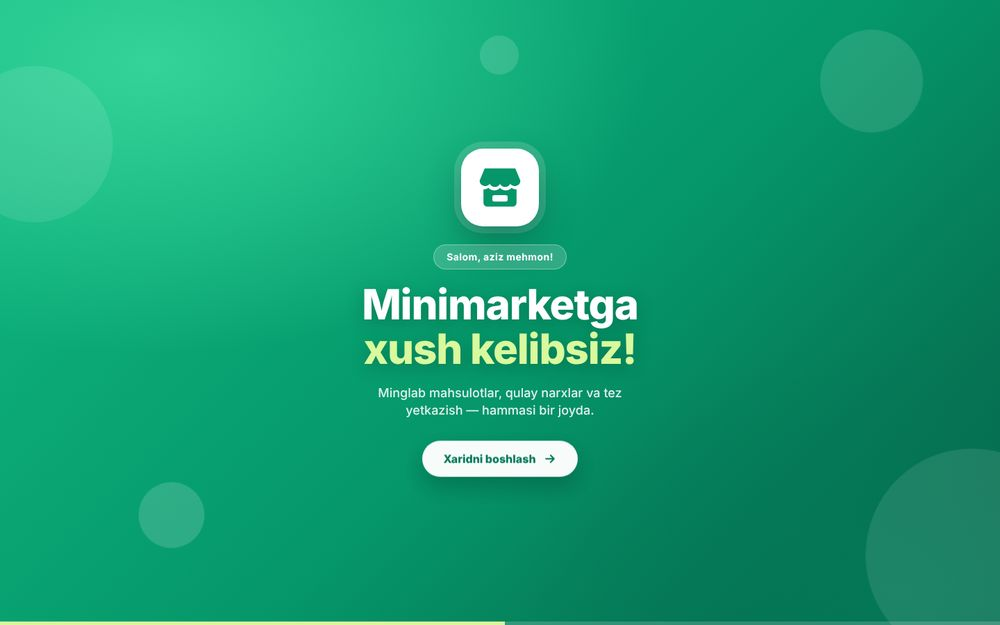
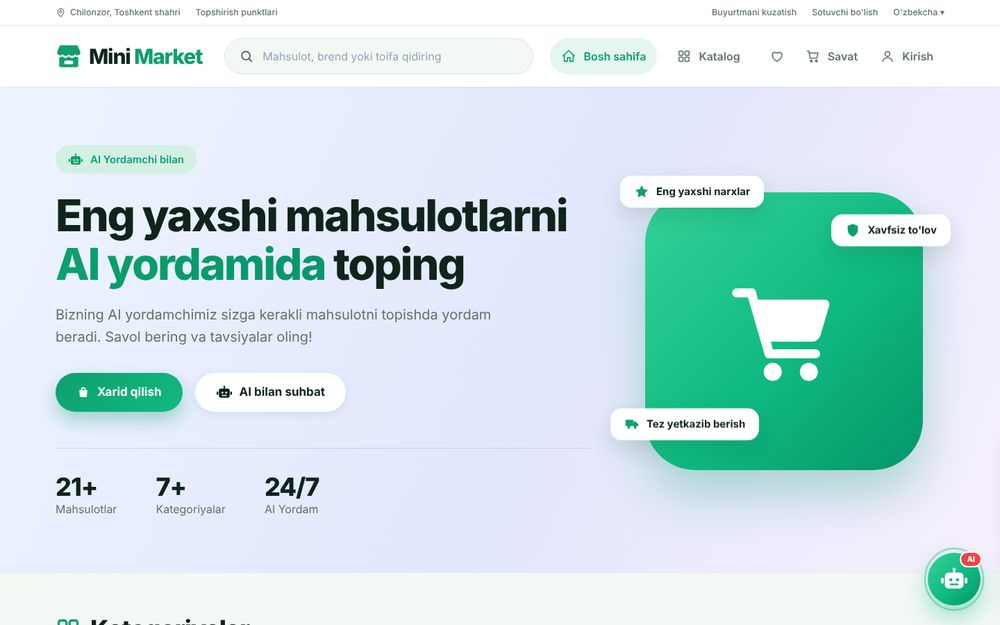
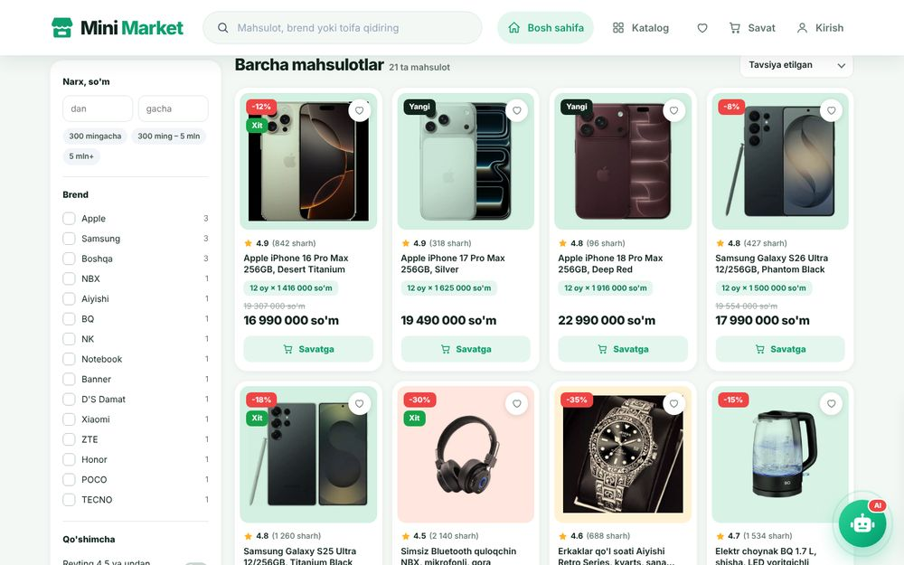
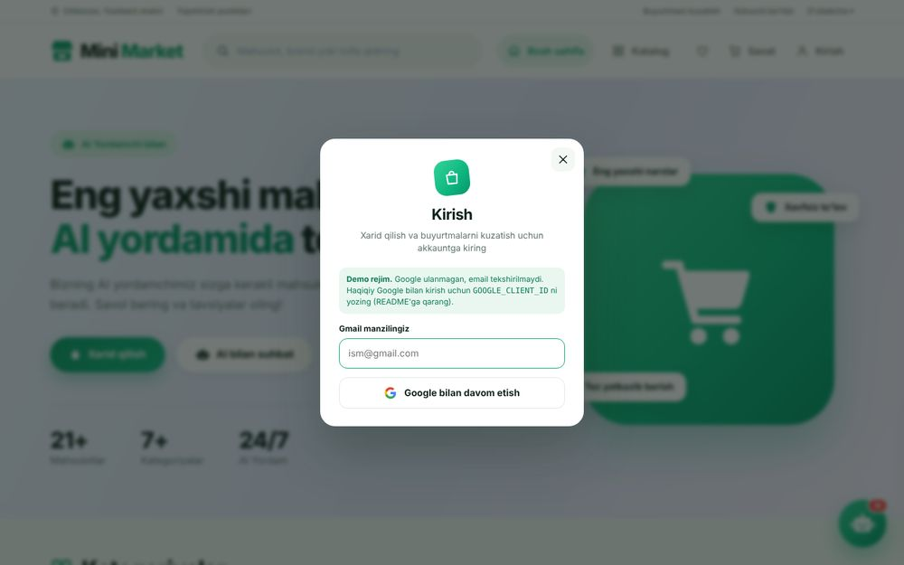
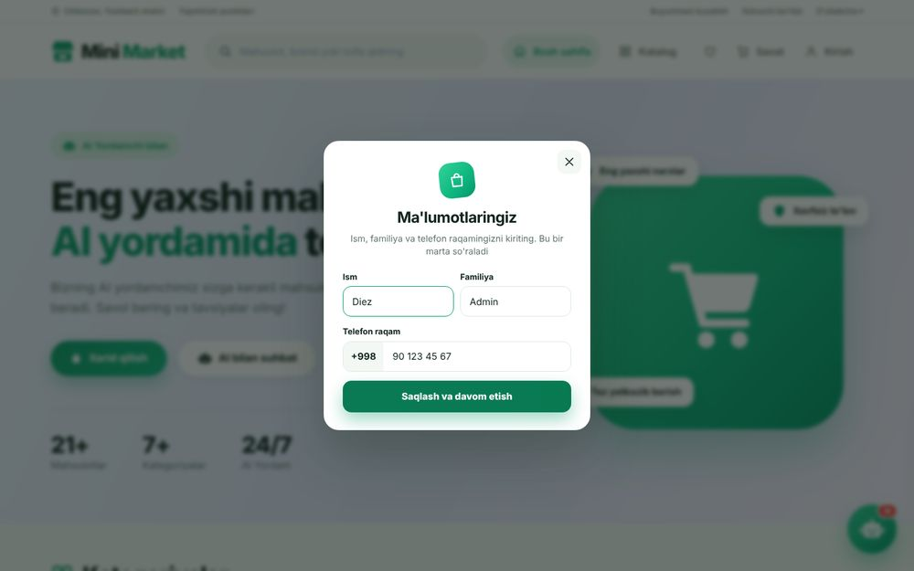
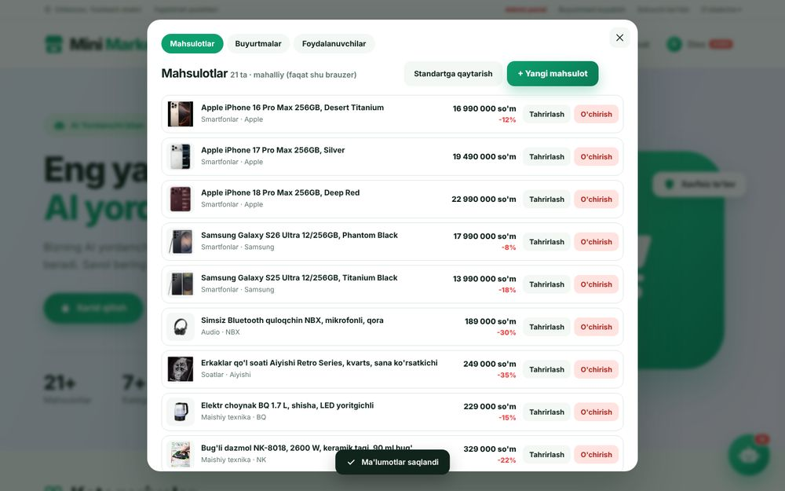
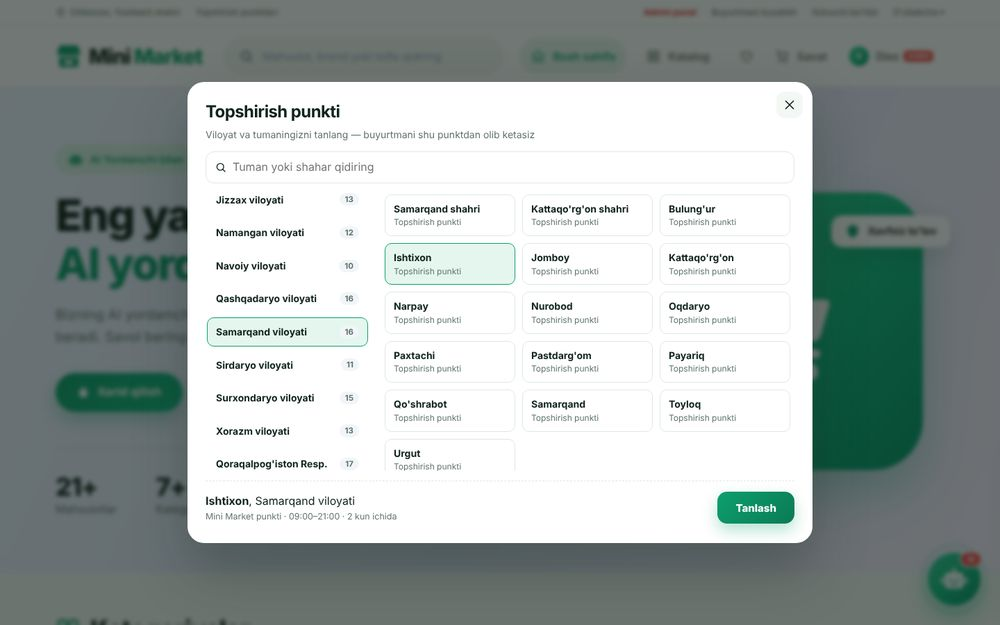
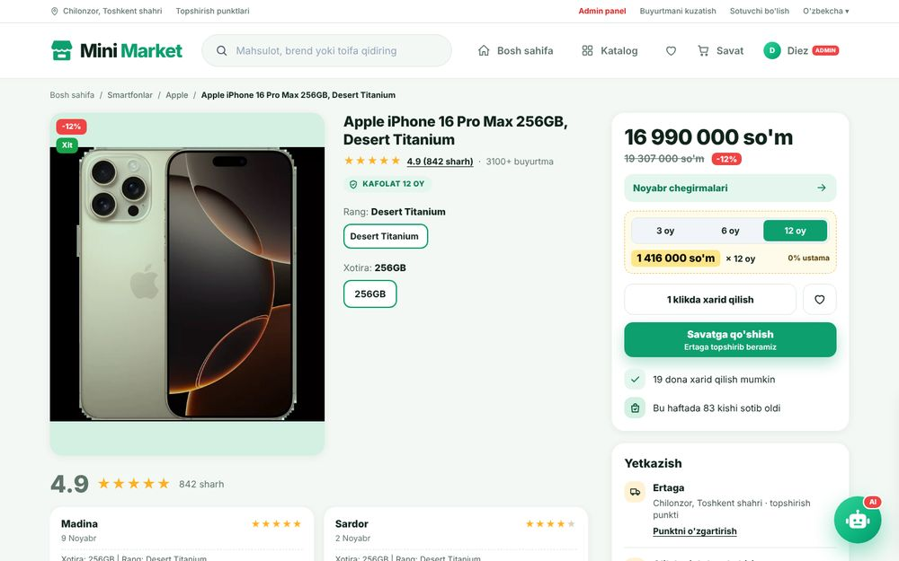
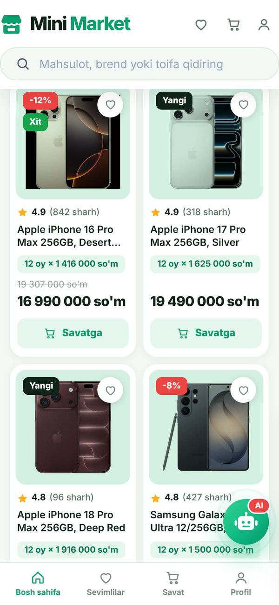
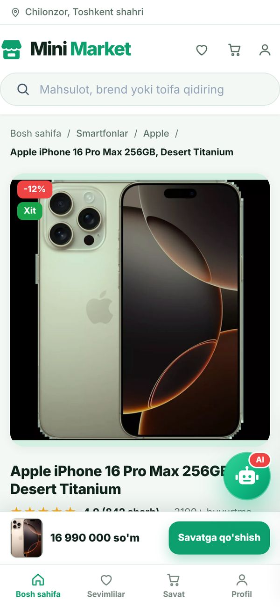

# Mini Market — marketplace katalog sahifasi

Onlayn marketplace uchun katalog sahifasi: Google bilan kirish, rollar (admin / xaridor), buyurtmalar, admin panel, topshirish punktlari va AI xarid yordamchisi.
Dizayn: oq sarlavha, yashil aksent, yumshoq kartalar va birinchi kirishda chiqadigan "Xush kelibsiz" oynasi.

## Skrinshotlar







| Kirish oynasi | Ism, familiya va telefon |
|---|---|
|  |  |







| Telefon: katalog | Telefon: mahsulot |
|---|---|
|  |  |

## Imkoniyatlar

**Xaridor uchun**
- Birinchi kirishda "Xush kelibsiz" oynasi chiqadi (keyingi kirishlarda chiqmaydi; bosib yoki `Enter` bilan yopiladi)
- Katalog, qidiruv, toifa chiplari, filtrlar (narx, brend, reyting, muddatli to'lov, chegirma), saralash
- Kartochka: chegirma, reyting, 12 oylik to'lov, "Savatga" tugmasi (−1+ ga aylanadi)
- Savat paneli, sevimlilar (har bir foydalanuvchiga alohida saqlanadi)
- To'liq moslashuvchan: telefonda pastki menyu, filtrlar pastdan chiqadi
- AI yordamchi (Market AI): byudjet va ehtiyoj bo'yicha mahsulot tavsiya qiladi, savatga qo'shadi

**Mahsulot sahifasi** (kartochkaga bosilganda ochiladi, manzil `#/p/<id>`, orqaga tugmasi ishlaydi)
- Galereya, rang (rasmli yoki rangli) va xotira tanlash, reyting, buyurtmalar soni, kafolat belgisi
- Xarid paneli: narx, chegirma, muddatli to'lov (3 / 6 / 12 oy), "1 klikda xarid qilish", sevimli, savatga qo'shish (−1+ ga aylanadi), qoldiq va haftalik sotuv
- Yetkazish (tanlangan topshirish punktiga qarab), qaytarish va kafolat, sotuvchi kartasi
- Sharhlar (surish tugmalari va "Hamma sharhlarni ko'rish"), "Mahsulot tavsifi" / "Xususiyatlari" yorliqlari, artikulni nusxalash
- Pastga tushganda tepada (telefonda pastda) narx va "Savatga qo'shish" bilan yopishqoq panel chiqadi
- "O'xshash mahsulotlar" va "Birga sotib olishadi" qatorlari
- Rang, xotira va xususiyatlar `index.html` dagi `DETAILS` obyektida (id bo'yicha). Yozilmagan mahsulotlar uchun nomidan avtomatik tuziladi. Sharhlar, qoldiq va sotuv soni namuna (demo) ma'lumot.

**Topshirish punktlari**
- 12 viloyat + Qoraqalpog'iston + Toshkent shahri, jami 200 dan ortiq tuman va shahar (`regions.js`)
- Yuqoridagi "Topshirish punktlari" yoki manzil tugmasi: viloyat → tuman tanlanadi, qidiruv bor
- Tanlangan punkt yuqori panelda, bosh sahifadagi "Tez yetkazish" kartasida (muddat viloyatga qarab) va savatda ko'rinadi
- Punkt tanlanmaguncha "Buyurtma berish" bosilganda oyna ochiladi; tanlov brauzerda saqlanadi
- Punkt nomlari va ish vaqti (09:00–21:00) namuna ma'lumot: haqiqiy manzillar kerak bo'lsa `regions.js` ni kengaytiring

**Kirish**
- "Kirish" tugmasi: Google bilan kirish oynasi
- Birinchi kirishda **ism** va **telefon raqam** so'raladi (keyingi kirishlarda so'ralmaydi)
- Mehmon savati kirgandan keyin foydalanuvchi savatiga qo'shiladi

**Rollar**
- `diezzminecraft@gmail.com` — **admin**
- Boshqa har qanday email (masalan `olmasovfayulloh1@gmail.com`, `fayzulloh12@gmail.com`) — oddiy **xaridor**
- Admin: yangi mahsulot qo'shadi (rasm yuklash bilan), tahrirlaydi, o'chiradi, yangi toifa yaratadi, standart mahsulotlarni tiklaydi. Kartochkalarda "Tahrirlash" va o'chirish tugmalari ko'rinadi.
- Adminlar ro'yxati `index.html` ichidagi `ADMIN_EMAILS` massivida.

## Ishga tushirish

O'rnatish talab qilinmaydi. VS Code'da **Live Server** bilan `index.html` ni oching yoki:

```bash
python3 -m http.server 5500
# http://localhost:5500
```

## Firebase ulash (tavsiya etiladi)

`firebase-config.js` dagi `window.FIREBASE_CONFIG = null` bo'lsa, sayt **mahalliy rejim**da ishlaydi (ma'lumot faqat shu brauzerda). Sozlama yozilsa, quyidagilar yoqiladi: haqiqiy Google bilan kirish (**Firebase Authentication**), hamma ko'radigan mahsulotlar va foydalanuvchi profillari (**Firestore**), admin huquqi esa serverda **qoidalar** bilan himoyalanadi.

1. [Firebase console](https://console.firebase.google.com/) → **Add project** (Analytics shart emas).
2. **Build → Authentication → Get started → Sign-in method → Google → Enable** (support email tanlang → Save).
3. **Build → Firestore Database → Create database** (production mode, yaqin region).
4. Firestore → **Rules** bo'limiga `firestore.rules` faylining mazmunini qo'ying → **Publish**. Admin emailini (`diezzminecraft@gmail.com`) o'zgartirsangiz, shu faylda ham o'zgartiring.
5. **Project settings (⚙) → General → Your apps → Web (</>)** → ilovani ro'yxatdan o'tkazing, chiqqan `firebaseConfig` ni `firebase-config.js` ga yozing.
6. **Authentication → Settings → Authorized domains** ga sayt domenini qo'shing (`localhost` odatda bor; Netlify'dan keyin `sizning-sayt.netlify.app`).
7. Saytga admin email bilan kiring va mahsulot qo'shing. Birinchi yozuvda standart mahsulotlar (21 ta) bazaga ko'chiriladi.
8. Baza avval to'ldirilgan bo'lsa, yangi namunalar (id 101–106) o'zi qo'shilmaydi: admin panelda **Yangi namunalar (+N)** tugmasini bosing.

Mahsulot rasmlari Firestore'da base64 sifatida saqlanadi (640px gacha kichraytiriladi), shuning uchun Firebase Storage va to'lov kartasi shart emas.

> `firebaseConfig` (apiKey ham) maxfiy emas, brauzerga baribir ketadi. Himoya `firestore.rules` orqali ta'minlanadi.

## Netlify'ga joylash

Sayt statik, build kerak emas (`netlify.toml` tayyor).

- **GitHub orqali:** loyihani GitHub'ga yuklang → [Netlify](https://app.netlify.com/) → **Add new site → Import an existing project** → repo tanlang → **Deploy** (build command va publish directory'ni o'zgartirmang).
- **Tez usul:** Netlify → **Add new site → Deploy manually** → loyiha papkasini sudrab tashlang.

Deploydan keyin Netlify bergan domenni (`xxx.netlify.app`) Firebase **Authorized domains** ga qo'shishni unutmang, aks holda Google bilan kirish `unauthorized-domain` xatosini beradi.

## Google Identity bilan kirish (Firebase'siz, ixtiyoriy)

Firebase ishlatmasangiz, Client ID bo'sh bo'lganda **demo rejim** ishlaydi (Gmail qo'lda yoziladi, tekshirilmaydi). Haqiqiy Google tugmasi uchun [Google Cloud Console](https://console.cloud.google.com/) → **Credentials → OAuth client ID → Web application**, **Authorized JavaScript origins** ga `http://localhost:5500` qo'shing va Client ID'ni `index.html` dagi `GOOGLE_CLIENT_ID` ga yozing. Bu usulda rol hanuz brauzerda tekshiriladi.

## Xavfsizlik va ma'lumotlar

- **Firebase yoqilgan bo'lsa:** admin faqat Google tasdiqlagan email bo'yicha aniqlanadi va yozish huquqi `firestore.rules` bilan serverda cheklanadi. Xaridor mahsulotni o'zgartira olmaydi, boshqaning profilini ko'rmaydi.
- **Mahalliy rejimda:** rol brauzerda tekshiriladi, dasturchi asboblari bilan aylanib o'tish mumkin. Demo rejimda email tekshirilmaydi. Faqat ko'rsatish uchun.
- Savat va sevimlilar har doim `localStorage` da (har bir foydalanuvchi uchun alohida).

## AI yordamchini ulash (haqiqiy AI)

AI yordamchi uch rejimda ishlaydi:

1. **Netlify'da (haqiqiy AI).** Sayt Netlify'ga joylanganda `/api/assistant` funksiyasi (`netlify/functions/assistant.mjs`) ishlaydi. U katalogni va savatni AI modeliga yuboradi, javob va tavsiya qilingan mahsulotlarni qaytaradi. API kalit faqat serverda (Netlify muhit o'zgaruvchisida) turadi, brauzerga chiqmaydi.
2. **Claude muhiti.** Sahifa Claude artifact ichida ochilsa, AI o'sha muhitning imkoniyati orqali ishlaydi.
3. **Demo.** `localhost` yoki fayl sifatida ochilganda, yoki serverda kalit bo'lmaganda oddiy qidiruv ishlaydi. Sarlavhada "Demo rejim" yoziladi.

### Netlify'da AI'ni yoqish

Funksiyalar Netlify'da **GitHub orqali joylashda** ishlaydi (papkani sudrab tashlash usuli funksiyalarni qo'llab-quvvatlamaydi).

1. Loyihani GitHub'ga yuklang.
2. Netlify → **Add new site → Import an existing project** → GitHub repo'ni tanlang → **Deploy** (sozlamalarni o'zgartirmang, `netlify.toml` tayyor).
3. Kalit oling (bittasi yetarli):
   - **Gemini:** [aistudio.google.com/apikey](https://aistudio.google.com/apikey) → **Create API key**.
   - **Claude:** [console.anthropic.com](https://console.anthropic.com/) → API keys (to'lov kerak bo'lishi mumkin).
4. Netlify → **Site configuration → Environment variables → Add a variable**:
   - Gemini uchun: `GEMINI_API_KEY` = kalitingiz
   - Claude uchun: `ANTHROPIC_API_KEY` = kalitingiz
   - ixtiyoriy: `GEMINI_MODEL` yoki `ANTHROPIC_MODEL` (model nomini o'zgartirish uchun; standart: `gemini-flash-latest` va `claude-haiku-5-5`)
5. **Deploys → Trigger deploy → Deploy site** (o'zgaruvchi qo'shilgach qayta joylash kerak).
6. Saytni oching, AI oynasi sarlavhasida **Online** yozilishi kerak.

Xato bo'lsa AI o'zi demo rejimga o'tadi, sayt to'xtamaydi. Model nomi eskirib `404` bersa, `GEMINI_MODEL` ga AI Studio'dagi joriy Flash modelini yozing.

## Loyiha tuzilmasi

```
index.html          # sahifa (HTML + CSS + JS bitta faylda)
regions.js          # viloyat va tumanlar (topshirish punktlari)
firebase-config.js  # Firebase sozlamasi (null = mahalliy rejim)
firestore.rules     # Firestore xavfsizlik qoidalari
netlify.toml        # Netlify sozlamasi
netlify/functions/  # AI funksiyasi (assistant.mjs)
images/             # mahsulot rasmlari
screenshots/    # README uchun skrinshotlar
```

## Texnologiyalar

Sof HTML, CSS va JavaScript. Bulut qismi: Firebase Authentication + Firestore (CDN orqali, o'rnatishsiz). Hosting: Netlify. Shrift: Manrope (Google Fonts).

## Eslatma

Narxlar, reyting va sharhlar namuna uchun yozilgan. "Mini Market" nomi va logotipi tasodifiy, real kompaniyaga tegishli emas.

## Yangilanishlar (yashil tema, doimiy kirish, admin)

- **Yashil tema:** butun sayt zumrad-yashil ranglarda (ko'k/binafsha qatlam almashtirildi).
- **Kirishni eslab qolish:** Google bilan bir marta kirgan foydalanuvchi (admin ham) keyingi safar avtomatik kiradi. Ism, familiya, telefon, savat, sevimlilar va topshirish punkti saqlanadi, qayta so'ralmaydi.
- **Ism va familiya** alohida so'raladi (birinchi kirishda bir marta).
- **Bir telefon = bir akkaunt:** Firebase yoqilganda raqam `phones/{raqam}` hujjati bilan akkauntga biriktiriladi va `firestore.rules` serverda tekshiradi. Mahalliy rejimda faqat shu brauzer ichida tekshiriladi.
- **Buyurtmalar:** "Buyurtma berish" endi buyurtmani saqlaydi (Firebase'da `orders`).
- **Admin panel:** Mahsulotlar, Buyurtmalar (holatini o'zgartirish: Yangi → Tasdiqlandi → Yo'lda → Yetkazildi / Bekor), Foydalanuvchilar (ism, email, telefon) va statistika.
- **Muhim:** yangi `firestore.rules` ni Firebase Console → Firestore → Rules ga qo'yib **Publish** qiling, aks holda telefon va buyurtma yozuvlari ishlamaydi.

## Yangilanishlar (Mini Market nomi va xush kelibsiz oynasi)

- **Yangi nom:** sayt nomi hamma joyda (sarlavha, logotip, footer, AI yordamchi) **Mini Market** qilindi. AI yordamchi endi **Market AI**.
- **Xush kelibsiz oynasi:** saytga har gal kirganda yashil to'liq ekranli oyna "Minimarketga xush kelibsiz!" yozuvi bilan chiroyli animatsiya bilan ochiladi. U ~4 soniyadan keyin o'zi yopiladi yoki "Xaridni boshlash" tugmasi / ekran / Enter / Esc bosilganda yopiladi.
- Matn va rangni o'zgartirish: `index.html` ichida `id="welcome"` bloki va `xush kelibsiz oynasi` CSS bo'limi.
- Firebase loyiha identifikatori (`firebase-config.js` dagi `mini-bozor-76227`) **o'zgartirilmadi**, chunki u o'zgarsa baza va Google kirish uzilib qoladi.
